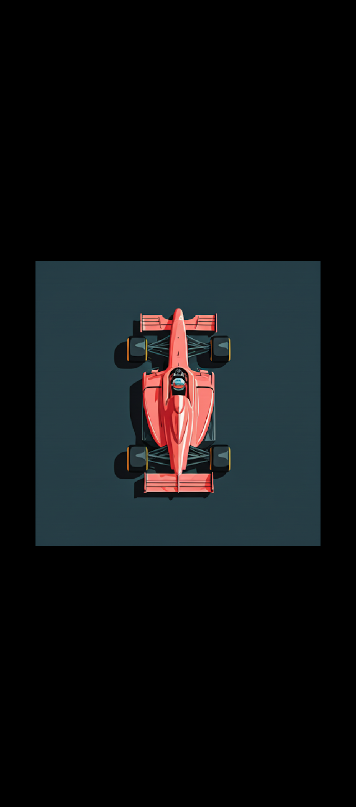

# F1 ML Simulation

AI cars learn to drive real Formula 1 circuits through neuroevolution. Track layouts and a
ghost car replaying a real qualifying lap come from F1 timing data via
[FastF1](https://docs.fastf1.dev/).



## Status

The project is mid-revamp; see [docs/revamp-plan.md](docs/revamp-plan.md).

- **Legacy app (works today):** `main.py` and the modules directly under `src/`. 30 cars, each
  driven by a small neural network, evolve on a track built from FastF1 telemetry while
  Hamilton's lap plays as a ghost. Its known limitations are measured in section 1 of the plan.
  The main one is that the "track" is one driver's racing line with fixed-width walls, not the
  real circuit.
- **New package `f1sim` (being built):** `src/f1sim/`, delivered milestone by milestone. It
  will have real track geometry in metres, F1-like physics, headless training and a new app.

| Milestone | Scope | State |
|---|---|---|
| M0 | Repo cleanup, packaging, tooling | done |
| M1 | Real track pipeline (TUM racetrack-database + FastF1 alignment) | done |
| M2 | Vectorised simulation core in SI units | done |
| M3 | Headless neuroevolution training | next |
| M4 | New app; legacy code removed | planned |
| M5 | More circuits, multi-track training, polish | planned |

## Setup

Requires Python 3.11+ (tested on 3.13).

```bash
python -m venv .venv
```

Activate it (`.venv\Scripts\activate` on Windows, `source .venv/bin/activate` on macOS/Linux), then:

```bash
pip install -e ".[dev,fast]"
```

The `fast` extra adds numba, which compiles the ray casts and track projection. With 64 cars,
the simulation runs at 64× real time with it and 17.6× without (`python scripts/bench.py`).

## Build tracks (new package)

List circuits, then build one from TUM data, aligned to a FastF1 qualifying lap:

```bash
f1sim tracks
```

```bash
f1sim build-track silverstone
```

Drive it yourself, or run the scripted reference lap that calibrates the physics:

```bash
f1sim drive silverstone
```

To race a real driver's lap, pass a ghost from `f1sim ghost` (it sets off when you cross the line):

```bash
f1sim drive silverstone --ghost path/to/ghost.npz
```

Set `F1SIM_NO_GLASS=1` to draw the HUD cards flat, without the offscreen scene and its blurred backdrop (for slow GPUs or debugging).

```bash
f1sim reference-lap silverstone
```

- **Without FastF1:** add `--no-fastf1` to build the geometry only, which skips the start line, sectors and alignment check.
- **Output:** tracks go to the user cache folder (`%LOCALAPPDATA%\f1sim\Cache` on Windows).
- **Known gaps:**
  - Reference laps come from OpenF1 for 2023 onwards. Older seasons go through FastF1, which only works for sessions already in its cache, because F1's live-timing server now needs an F1 TV subscription.
  - Pick the source with `--source openf1|fastf1`.
  - Suzuka's figure-eight isn't supported yet.
  - Circuits missing from TUM need the M5 fallback.

## Run the legacy app

Run it from the repo root, because it reads and writes `cache/` relative to the current folder:

```bash
python main.py
```

- **First run:** each new circuit downloads its session data from FastF1, which takes a while
  and freezes the window until it finishes. Silverstone 2024 is the default.
- **Sidebar:** pick a year and circuit, then press **Load Track**. The slider sets the sim
  speed.
- **Cache:** downloaded data goes to `cache/`, which git ignores.

## Development

```bash
ruff check
```

```bash
pytest
```

## Layout

```
main.py, src/*.py      legacy app (deleted in M4)
src/f1sim/             new package (see docs/revamp-plan.md, section 3)
tests/                 pytest suite
docs/revamp-plan.md    problems, target design, milestones
docs/data-formats.md   file-format spec for tracks, ghosts, checkpoints, runs
```

## Credits

- Timing and telemetry data: [FastF1](https://github.com/theOehrly/Fast-F1). Formula 1 data is
  the property of Formula One World Championship Limited; this is an unofficial hobby project.
- Planned from M1: track centre lines and widths from the
  [TUM racetrack-database](https://github.com/TUMFTM/racetrack-database) (LGPL-3.0),
  downloaded at build time and not redistributed.
